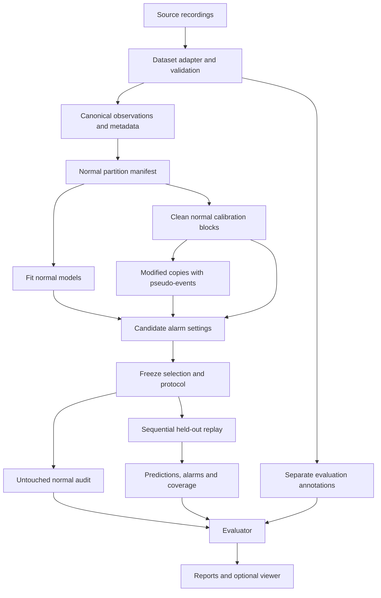

# Technical architecture

Last updated: 2026-10-14  
Status: implementation design; this file does not imply that the modules below already exist.

## 1. Authority, scope and design intent

Read `project-overview.md` first. That file defines purpose and scope; this file defines implementation boundaries and scientific invariants. Applicable repository instructions and explicit human decisions take precedence. Do not silently resolve a substantive contradiction between context files: record it and reconcile the affected documents.

Build a local, reproducible Python application around a pinned GeCo implementation. The first milestone is offline calibration on one HAI release. Dependency-aware monitoring follows. Alternative checks, operating modes, second-process evaluation and responsive physical simulation are staged features, not prerequisites for baseline reproduction.

The architecture deliberately separates observations, model decisions and evaluation truth. Its most important property is that training, calibration and replay cannot consume privileged attack or degradation annotations.

## 2. Technology decisions

These are selected defaults to verify during setup, not a list of packages already installed or proven compatible.

| Concern | Decision | Boundary / rationale |
| --- | --- | --- |
| Runtime | Python 3.11 as the initial compatibility target | Verify with pinned GeCo before locking the environment; record a different tested minor version if necessary. |
| Numerical work | NumPy and SciPy | Reuse upstream numerical behaviour; avoid an independent detector rewrite before parity is established. |
| Tabular processing | pandas | Dataset parsing, alignment, validation and reporting. |
| Table storage | Parquet using PyArrow | Preserve explicit timestamps, numeric types and nulls; verify round trips. CSV is an export, not the authoritative store. |
| Configuration/contracts | Pydantic v2 and JSON | Reject unknown fields and invalid values. Validate cross-field scientific constraints separately. |
| Detector | Pinned IPAL/GeCo revision, wrapped by an adapter | All upstream imports stay inside the integration layer. Record revision, source hash and any patches. |
| Orchestration | Python CLI using standard-library argparse | One command path for reproducible experiments; notebooks call the same application functions. |
| Persistence | Filesystem artifacts and manifests | No database, queue or distributed service is required for the core. |
| Plots | Matplotlib | Reproducible static research figures. |
| Optional interface | Streamlit | Read completed artifacts; widget reruns must not retrain models or advance detector state. |
| Verification | pytest; Ruff for formatting/linting | Focus tests on leakage, state, contract and metric correctness. |
| Packaging | `pyproject.toml` and a generated exact-version dependency lock | Lock the verified environment, including transitive dependencies; record platform and numerical backend. |

Prefer one verified environment. If upstream IPAL introduces incompatible or unnecessary dependencies, isolate GeCo in a local subprocess environment with file-based contracts. Do not install every detector framework dependency merely because it appears in the upstream requirements file. Document the tested minimal installation path.

No GPU, cloud subscription, LLM, FastAPI service, Docker deployment or database is assumed. Add infrastructure only for a demonstrated requirement. This architecture document does not create a dependency lock or establish installation compatibility.

## 3. System boundaries

### Inside the system

- Import approved offline recordings and documented sensor metadata.
- Validate and partition normal data; fit and export GeCo models.
- Generate controlled disturbances in copied data and select detector configurations.
- Replay observations sequentially and emit predictions, alarms and monitoring status.
- Track check dependencies and, later, select independently validated alternative checks.
- Evaluate frozen predictions against separately held annotations.
- Produce auditable reports and an optional artifact viewer.

### Outside the system

- Dataset access approval, source licences and industrial historian acquisition.
- Physical PLC control, network blocking, live attack execution and safety interlocks.
- Authoritative identification of attacker intent or assurance that a compromised device is clean.
- Unrestricted online learning, autonomous model deployment and automatic physical recovery.

A later simulator is an evaluation environment. Only that optional component may enact response policies against its simulated plant. It must not introduce a path to real equipment. Static replay alone cannot establish physical downtime or service-continuity improvements.

## 4. Proposed repository layout

The tree below is a target layout. Existing `work/`, `tmp/`, `output/`, `outputs/` and proposal-generation scripts are research/proposal artifacts, not the application. Do not move or remove them as part of writing this architecture.

```text
project-root/
  project-overview.md
  architecture.md
  README.md                        # verified setup and execution instructions
  pyproject.toml
  requirements.lock                 # generated from the verified environment
  .gitignore
  configs/
    datasets/                      # release, parsing and metadata configuration
    experiments/                   # budgets, search, event generation and metrics
  docs/
    decisions/                     # architecture/experiment decision records
    experiments/                   # results, failures and next-step notes
  src/resilient_monitoring/
    cli.py
    config.py
    contracts.py                   # versioned input/output schemas
    data/
      adapters/                    # HAI first; SWaT later
      validation.py
      partitions.py
      preprocessing.py
    detectors/
      base.py                      # project-facing detector interface
      geco_adapter.py
      geco_runner.py               # process boundary and upstream serialization
    events/
      specifications.py
      generators.py
      constraints.py
    calibration/
      search.py
      objective.py
      stability.py
      selection.py
    monitoring/
      quality.py
      registry.py
      eligibility.py
      replay.py
      state.py
      coverage.py
      alternatives.py              # staged
      modes.py                     # conditional extension
    evaluation/
      annotations.py               # privileged evaluation data access
      matching.py
      metrics.py
      comparisons.py
    artifacts/
      manifests.py
      hashing.py
      storage.py
    reporting/
      tables.py
      plots.py
  apps/
    dashboard.py                   # optional, read-only artifact viewer
  tests/
    unit/
    integration/
    fixtures/                      # tiny synthetic data, no restricted recordings
  third_party/
    geco/                          # pinned checkout or documented equivalent
  data/                            # ignored except documentation/manifests
    raw/<dataset>/<release>/
    canonical/<dataset>/<release>/
    truth/<dataset>/<release>/     # annotations; evaluator only
  artifacts/                       # generated, unique directories per experiment
    <run_id>/
      manifest.json
      config.resolved.json
      split_manifest.json
      models/
      events/                      # evaluator metadata, not replay inputs
      predictions/
      selection/
      evaluation/
      reports/
      logs/
  notebooks/                       # exploratory; no exclusive production logic
  work/                            # existing research checkouts, not canonical code
  tmp/
```

Paths in contracts are relative to the configured workspace/data root. Do not hardcode a teammate's drive, username or absolute local path. Raw datasets and generated models/results are not committed by default. Small non-sensitive manifests, configurations and source code are version controlled.

## 5. Module dependency rules

1. `contracts` and `config` must not import dataset adapters, detector implementations or the UI.
2. Dataset adapters produce canonical contracts; other modules do not branch on raw CSV column conventions.
3. GeCo implementation details are confined to `detectors/geco_*`. Monitoring consumes exported check metadata and project-facing results.
4. Calibration consumes normal partitions and synthetic-event metadata. It does not import the real-attack annotation loader.
5. Monitoring consumes observations, observable quality evidence, frozen models and selected configurations. It does not import evaluation or event truth.
6. Evaluation joins completed predictions with annotations. It may call replay to produce predictions but cannot supply annotations to replay.
7. Reporting and UI read results; they do not define selection objectives or detector semantics.
8. The CLI orchestrates these modules. Core modules do not invoke the CLI or depend on Streamlit.

## 6. Data flow and experiment lifecycle



Use half-open intervals `[start, end)` consistently. Proposed lifecycle:

`draft -> data_validated -> baseline_verified -> calibrated -> frozen -> evaluated`

A failed/infeasible stage is recorded explicitly; it does not become a successful zero-alarm run. `frozen` identifies an immutable selection package and evaluation protocol. Audit and test results are read-only evidence after freezing. If they inform a redesign, start a new development cycle and disclose reuse or obtain fresh held-out data.

Stages communicate through versioned artifacts. They can run as separate local processes; no access-control guarantee follows from directory names alone. Limit loaded files and process arguments by role and test the boundary.

## 7. Canonical contracts

All persisted contracts carry `schema_version`. Validate on read and write; reject unsupported versions rather than guessing conversions. Migrations must be explicit and preserve provenance.

### Observation dataset

- Identity: `dataset_id`, `release_id`, `run_id`, `segment_id`, `sample_id`.
- Time: original timestamp, normalized ordering timestamp, original timezone/unknown-timezone policy, and sampling metadata.
- Values: one column per stable channel ID; explicit nulls for unavailable measurements.
- Observable quality: a separate keyed mask/table containing missing, stale, invalid or available status and evidence source.
- Channel metadata: units (or explicitly unknown), numeric/discrete type, valid discrete states, documented ranges, sensor/actuator role and optional subsystem.

Within a segment, order is strictly increasing under the declared time policy and each sample/channel key is unique. Reject or explicitly resolve duplicate timestamps. Do not assume an undocumented timezone; record an unknown-timezone interpretation without claiming UTC. Preserve reversible channel-name mapping.

The observation schema must not contain `attack`, attack ID, fault class, synthetic-event family, injected-channel identity or other evaluation truth. Quality flags caused by observable missingness are allowed; a flag obtained only from injection metadata is privileged.

### Split manifest

Identify source checksums and exact segments/ranges for `normal_train`, `normal_calibration`, `normal_audit`, `attack_test`, and optional `pseudo_holdout`. Include normal-label provenance, window/lag lengths, excluded intervals and warm-up policy. Disjoint sample IDs are necessary but insufficient: account for overlapping windows and event/run grouping.

### Pseudo-event specification

Fields: `event_id`, family, source partition/block, affected channels, `[start,end)`, severity and units, duration, seed, generator version, constraint policy, composition order and source checksum. Declare the attack capability assumed by coordinated changes. Record actual altered support when clipping or constraints change the requested event.

Write a modified observation copy and separate event metadata. Replay receives the modified observations, never family labels or affected-channel truth. Calibration scoring can read the metadata after replay.

### Model and check registry

Each check records `check_id`, target, every `(channel_id, lag)` needed for prediction and observed comparison, equation/template, coefficients, upstream model reference, training-data/preprocessor hashes, supported conditions, validation evidence, settings, baseline/fallback role and alternative relationships.

Include the target's historical input and current observation wherever required. Reject incomplete upstream models for final evaluation. Dependencies come from the executed model, not a manually guessed causal graph.

### Monitoring output

Key each row by sample, target and check. Include prediction if available, residual if comparable, cumulative score, threshold, alarm value, check eligibility, reason codes and chosen alternative. Use nullable alarm values: `null` means no valid decision, not normal.

Store target-level coverage separately from anomaly status. Record `supported`, `degraded`, `unavailable`, or `initializing` with reasons, current conditions, evidence and any uncertainty estimate. Estimates without observed targets are marked `estimate_only` and do not count as residual-check coverage.

### Run manifest and frozen selection

Record exact resolved configuration, source and derived hashes, code revision/dirty diff hash, GeCo revision/patch hash, dependency-lock hash, platform, seeds, time, stage, warnings, resource use, partition identities, metric protocol and artifact hashes. Record nondeterminism/tolerances where bitwise reproducibility is not realistic.

A selected configuration includes its candidate grid, score components, empirical false-alarm constraint, stability criteria, tie-break rule and validation evidence. Failure states include `no_feasible_configuration`, `invalid_data`, `fit_failed` and `unsupported_condition`.

## 8. GeCo integration contract

### Upstream boundary

Use the official implementation/reproducibility artifact as the baseline. The existing `work/geco-review` checkout is a review reference, not an automatically approved production dependency. Pin and verify the chosen revision before fitting. Preserve upstream attribution and licence.

The locally inspected implementation currently maps:

| Project setting | Upstream key |
| --- | --- |
| `k` | `max_formel_length` |
| `S` | `threshold_factor` |
| `G` | `cusum_factor` |

It exports check information under `CI`, including equation, ordered `combination`, parameters, drift and threshold. It uses state messages with `timestamp` and `state`. Verify these details against the final pin; fail on incompatible schemas.

### Prediction and alarm semantics

In the inspected checkout, each check predicts the current target using its previous reading and other previous readings. Its alarm accumulation has the form:

```text
residual_t = prediction_t - observation_t
C_t = max(C_previous + abs(residual_t) - drift - epsilon, 0)
C_t = min(C_t, threshold * S + drift * G + epsilon)
alarm_t = C_t > threshold * S
```

`G` affects the cap/overshoot and subsequent alarm persistence; it is not the magnitude of an injected drift event. The actual pinned implementation is authoritative. If changed, version the detector behaviour and establish a new baseline.

The project adapter exposes `fit`, `load`, `export_checks`, `start_segment`, `step`, and `save` responsibilities. Exact Python signatures can be chosen during implementation; semantics above must remain explicit. Where a thin process wrapper is necessary, retain identical contracts.

### Parity and extensions

First reproduce upstream fitting, predictions, alarm state and output aggregation on complete inputs. A custom selective replay engine for missing inputs/alternatives is allowed only after parity tests on complete data. Upstream code expects observations to exist; do not pass NaN through it and interpret the resulting output as meaningful.

Separate `baseline` and `resilient` replay policies. The former preserves upstream first-sample initialization behaviour for parity. The latter makes absence of an initial prediction explicit as `initializing`. Exclude/report initialization intervals consistently in comparisons.

Fitting adjacent transitions across independent runs or gaps is invalid. The inspected fitter works over a flat state sequence; fit contiguous segments separately initially. Pooling transitions requires an explicit segmented integration change and its own verified baseline. Never concatenate unrelated segments silently.

Cache residuals only when model, observations, channel order, preprocessing and prediction policy match. Changes to `S` or `G` require fresh sequential alarm accumulation even when residuals are reusable. Any modification affecting predictions invalidates the residual cache.

## 9. Calibration engine

1. Validate the experiment config and partition manifest before computing results.
2. Fit normal models and normal-data statistics. Candidate `k` is initially a single fixed value.
3. Generate reproducible pseudo-events from normal calibration blocks; include event-free context and an explicit reset/warm-up policy.
4. Replay every candidate on identical untouched normal blocks and identical pseudo-event realizations.
5. Aggregate normal alarms into episodes under a fixed rule; also compute alarm-time fraction and unavailable time.
6. Reject candidates exceeding budget or other predeclared validity/coverage criteria. Abstaining everywhere cannot satisfy selection.
7. Rank feasible candidates by the predeclared family-balanced detection/delay utility and stability rule.
8. Apply a deterministic, documented tie-break; freeze the candidate and protocol, then run audit/final evaluation.

Compute false-alarm episodes per day using declared usable normal exposure; additionally report total elapsed time, unavailable exposure, and duration in alarm. Unknown ground truth is not normal exposure. Rare-budget estimates require sufficient recorded time; report uncertainty and inadequate duration.

Synthetic utility uses event-level detection and delay, with missed-event handling defined before search. Do not score every post-injection timestamp as an immediate return to normal: cumulative alarm state can persist. Score operational false alarms on separate untouched normal copies.

Reject unspecified budgets, severity units, search limits or score weights at experiment execution. The architecture supplies no invented plant-specific defaults. Baseline, search objective, all evaluated candidates and failures must be retained in artifacts.

## 10. Dependency-aware replay and state

At time `t`, a check is eligible only if all required observations at the exact required lags and its current comparison target are usable, its model is complete, and its condition is supported. Do not look ahead, backfill from future samples or bridge an unvalidated gap.

The core degradation evaluation uses observable missingness and separately identified known-degradation experiments. A supplied affected-channel mask is an oracle assumption and must be labelled as such; it cannot be presented as automatic localization. Unknown-manipulation inference is a later component that receives no injected-channel truth.

### State ownership

- One replay engine owns ordered observations and the logical clock per independent stream.
- Each `(stream, check, model version, calibration version, mode)` owns separate cumulative state/history.
- Candidate configurations and experiment replicas never share mutable state.
- Reset at independent segment boundaries. Record all resets and warm-up exclusions.
- Proposed resilient policy: mark invalid checks unavailable, invalidate their accumulator/history, then warm up from newly valid consecutive observations before reactivation. Validate this policy; it differs from uninterrupted baseline replay.
- Fallback checks start cold unless explicitly maintained on valid history in advance. Never copy one check's accumulator into another.
- Mode transitions have an explicit state policy; do not inherit state implicitly or hide transition alarms.

### Coverage and alternatives

Define the monitored-target denominator before evaluation and retain unsupported targets in reports. Coverage counts targets with eligible comparable checks, not the number of equations or display widgets. Report shared dependencies and quality limitations; several checks with the same input are not independent corroboration.

An alternative is independently fitted, calibrated and validated under its dependency set. Select using frozen eligibility/ranking rules, never test labels or future error. The same restrictions apply to lagged self-inputs. If only an estimate remains, report estimation availability separately from anomaly-monitoring coverage.

Eligibility establishes support under stated evidence, not proof that measurements are trustworthy. Even `supported` checks can be defeated by coordinated manipulation. Report measured detection under such scenarios separately.

## 11. Extension boundaries

### Operating modes

Prefer documented state tags and interpretable rules. Fit mode definitions on development normal data. Begin with separate calibration; add separate equations only if justified. A mode-selector dependency can itself fail, making the condition unknown. Validate normal dwell time, transitions and unfamiliar conditions. Reject a configured mode without sufficient training/calibration exposure.

### Portability

Add dataset adapters and metadata without introducing dataset-specific logic into calibration/coverage modules. Refit and recalibrate using each process's normal data. Record manually supplied constraints and effort. Freeze the procedure before the second test; modifications informed by that test require disclosure and re-evaluation.

### Diagnosis, reinstatement and physical simulation

Pattern characterization emits hypotheses such as freeze-like, bias-like, mixed or unknown. Attacker attribution requires an independent evidence contract that does not yet exist. Reinstatement verifies monitoring consistency under a declared policy; it does not certify attack removal. A simulator and response policy are separate optional components with separate physical metrics.

## 12. Artifacts, execution and resource policy

Proposed CLI stages: `prepare`, `fit-baseline`, `generate-events`, `calibrate`, `freeze`, `replay`, `evaluate`, and `report`. These are planned interfaces, not commands currently available. Every stage takes a validated config and explicit input manifest, writes a unique output location, and records resolved inputs. Evaluation alone accepts real annotation paths.

Generate new run IDs instead of overwriting completed results. Use atomic writes where practical; an interrupted stage remains incomplete. Resume only when source/configuration hashes match and upstream resume behaviour is verified. Reject incomplete fit artifacts for frozen selection.

Bound candidate count, CPU workers, memory and runtime. Begin with a subsystem and one fit, measure costs, then increase scope. On Windows, verify upstream multiprocessing behaviour and import guards before assuming parallel fitting works. Sequential replay within each stream is mandatory; parallelize independent fits, candidates or runs only with isolated state and output paths.

The dashboard reads artifacts with validated schemas and shows run/configuration identity, evidence and unavailable status. It cannot launch hidden experiments on rerun. UI session state is not the source of scientific results. Keep detector processing out of widget callbacks.

## 13. Invariants agents must never violate

These apply to implementation, tests, notebooks, reports and demos. A later design change must preserve them or explicitly amend the affected scientific claim with team approval.

| ID | Invariant | Required enforcement |
| --- | --- | --- |
| I01 | Raw source data is immutable. | Checksums; write derived copies elsewhere. |
| I02 | Real attack truth never reaches fitting, pseudo-event design, selection or runtime decisions. | Feature allowlists, module/process input boundaries, leakage tests. |
| I03 | Only declared normal development data fits models, transforms and mode definitions. | Fit provenance and partition checks. |
| I04 | Runs/events/windows do not leak across splits; dependencies respect boundaries. | Split validation including lags and windows. |
| I05 | Future observations are never used for current replay decisions. | Prefix-invariance test: appending future data cannot change earlier outputs. |
| I06 | Timestamps, units, channel order and missingness remain explicit. | Canonical contract and round-trip tests. |
| I07 | No silent filling, clipping, resampling, timezone assumption or unknown config key. | Validated policies and transformation logs. |
| I08 | Every event is reproducible and leaves originals unchanged. | Seed/version manifest and source hash tests. |
| I09 | Synthetic metadata is evaluator information, not a runtime hint. | Separate files/loaders; paired replay checks. |
| I10 | Missing/stale data is not automatically a detected cyberattack. | Distinct quality and anomaly outputs. |
| I11 | Every executed check has complete dependency metadata, including target history. | Extract from model; validate registry against execution. |
| I12 | An unavailable comparison emits no valid normal decision. | Nullable alarms and explicit status/reasons. |
| I13 | An estimate is never passed off as an observation or independent corroboration. | Provenance types and separate coverage accounting. |
| I14 | Alternatives have independent fitting, calibration and validation. | Eligibility requires evidence artifact. |
| I15 | Mutable detector state cannot leak between candidates, streams or replicas. | Reset and state-isolation integration tests. |
| I16 | Cached data is reused only under matching semantics and provenance. | Cache keys include all prediction-affecting hashes. |
| I17 | Upstream baseline behaviour is reproduced before modified replay is compared. | Prediction/alarm parity tests, versioned differences. |
| I18 | Invalid inputs, fit failure and infeasible search cannot become successful quiet runs. | Typed failure states and failing stage exit status. |
| I19 | Objective, exposure, aggregation and event matching are fixed before test inspection. | Frozen protocol hash. |
| I20 | Audit/test-informed redesign invalidates an untouched-test claim. | New run lineage and explicit evaluation disclosures. |
| I21 | Coverage denominator is fixed and unavailable time stays visible. | Metric tests against tiny known cases. |
| I22 | Supported monitoring does not mean guaranteed safety or malicious-intent attribution. | Report/UI wording and evidence fields. |
| I23 | No online retraining on suspicious data, blanket transition suppression or autonomous physical action. | No such path in core modules; extension review. |
| I24 | The second process uses newly fitted models; portability effort and exceptions are recorded. | Process-specific manifests with shared-method hashes. |
| I25 | Restricted recordings, secrets and private paths are not published. | Ignore rules, fixture policy and export review. |
| I26 | Results and savings are reported only when measured; simulations are labelled. | Claims link to run artifacts and assumptions. |
| I27 | Existing user/research work is preserved and completed artifacts are not silently overwritten. | Unique run outputs and scoped file changes. |

## 14. Verification and acceptance gates

### Gate A: first calibration milestone

- Canonical data, timestamp policy and exact normal/test partitions are validated.
- Pinned upstream baseline runs on a manageable contiguous subsystem.
- Predictions, residuals, alarms, runtime and model provenance are recorded.
- Bias, drift and freeze generation passes source-immutability and event-support checks.
- Candidate settings run on identical inputs with isolated sequential state.
- Selection includes all candidates/failures and a reproducible frozen protocol.
- Normal audit and attack evaluation are produced without labels entering calibration.

### Gate B: monitoring resilience

- Registry dependencies match actual executed inputs, including lags.
- Known single-sensor loss invalidates exactly the dependent checks.
- Missing-target estimates never count as successful comparisons.
- At least a small validated alternative library is tested where feasible; no-alternative cases remain visible.
- Switching, reset, reactivation and cold-start policies have meaningful regression tests.
- Retained coverage, detection, unavailable duration and estimation errors are evaluated separately.

### Extension gates

Modes require documented interpretations, sufficient exposure and transition evaluation. Portability requires a second process with fixed-method reporting. Physical-resilience claims require a responsive simulator. Unknown-sensor inference requires a separate end-to-end localization evaluation.

Use synthetic fixtures to verify scientific semantics without redistributing restricted data. Compare repeated results within recorded numerical tolerances. No requirement for exhaustive UI tests in the first milestone.

## 15. Open decisions and evidence sources

Still to decide and record: HAI release/subsystem, exact GeCo revision, tested Python/package versions, time interpretation, actual splits, event magnitudes/durations, fixed `k`, `S/G` search ranges, score weights, alarm budget, exposure requirements, switching/warm-up policy and feasible compute resources. Do not convert these unknowns into undocumented defaults.

Architecture changes need a short decision record with rationale, affected invariants and verification. Update `project-overview.md` if scope changes; update setup instructions only with tested commands. A GeCo pin or semantic change requires rechecking parity and provenance.

References used for design:

- Local reviewed source: `work/geco-review/ids/geco/geco.py` (review snapshot, not final pin).
- [Official GeCo paper and presentation](https://www.usenix.org/conference/usenixsecurity25/presentation/wolsing).
- [GeCo reproducibility artifact](https://zenodo.org/records/15120036).
- [pandas storage documentation](https://pandas.pydata.org/docs/user_guide/io.html): typed Parquet interchange; explicit index/time handling.
- [Pydantic strict mode](https://docs.pydantic.dev/latest/concepts/strict_mode/) and [model configuration](https://docs.pydantic.dev/latest/concepts/models/): reject invalid/coerced inputs and extra fields.
- [Streamlit execution and session state](https://docs.streamlit.io/develop/concepts/architecture/session-state): reruns motivate a read-only artifact-viewing boundary.

Library documentation was checked through Context7 on 2026-10-14. Exact installed versions and baseline compatibility remain to be verified during implementation.
